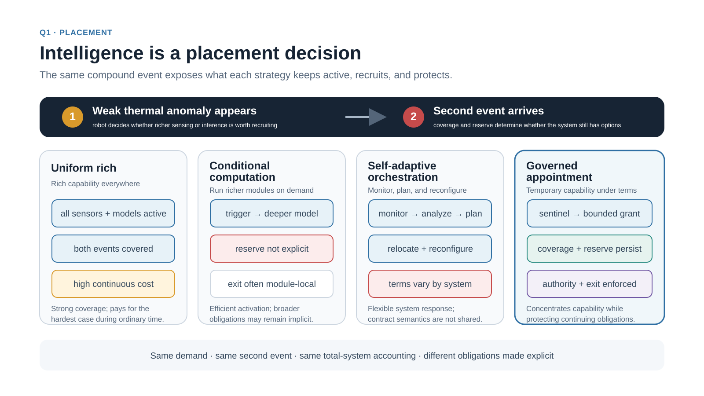
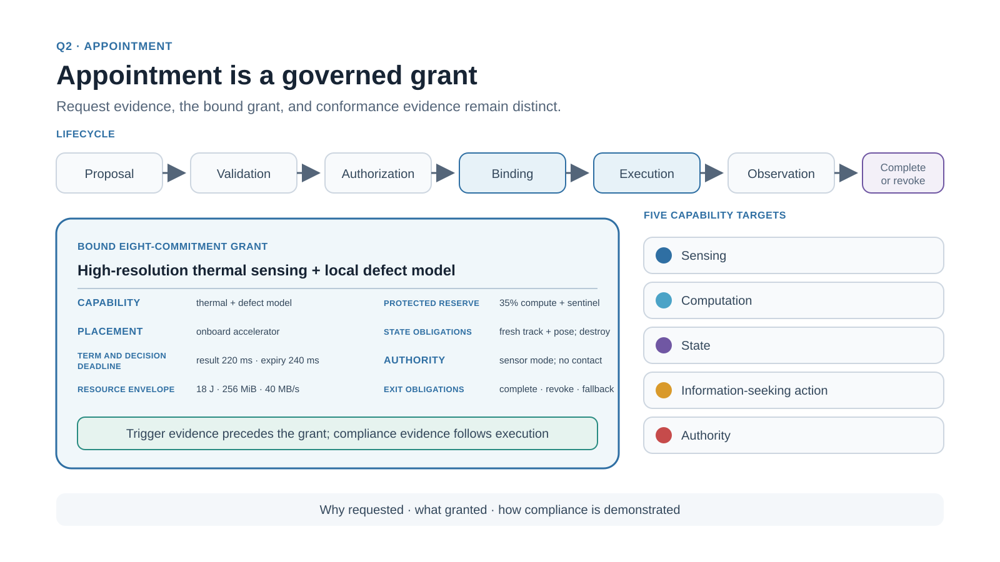
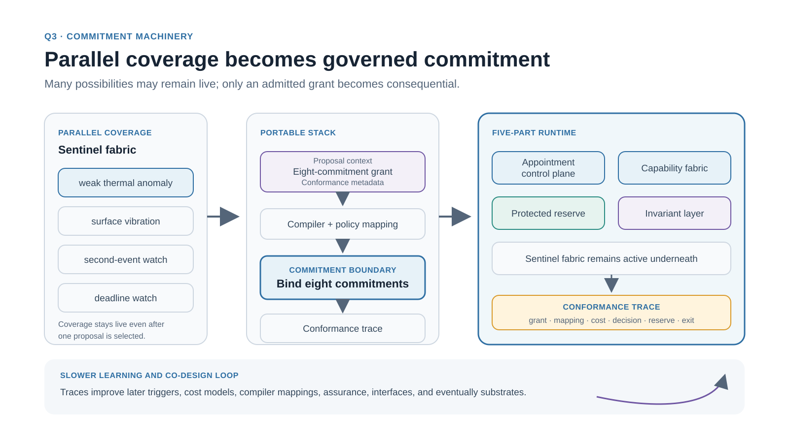
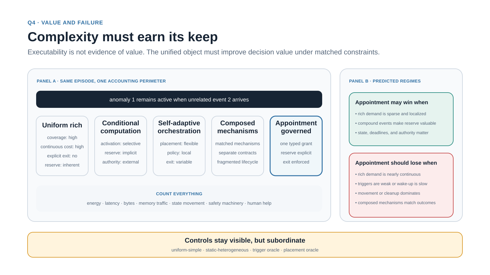
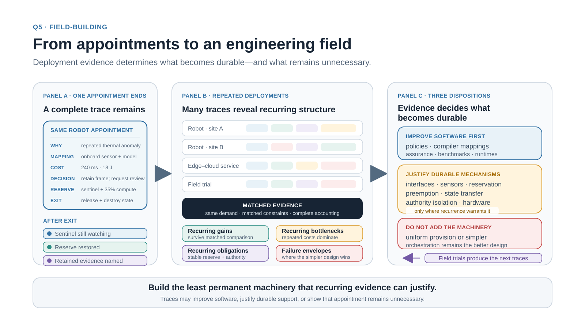
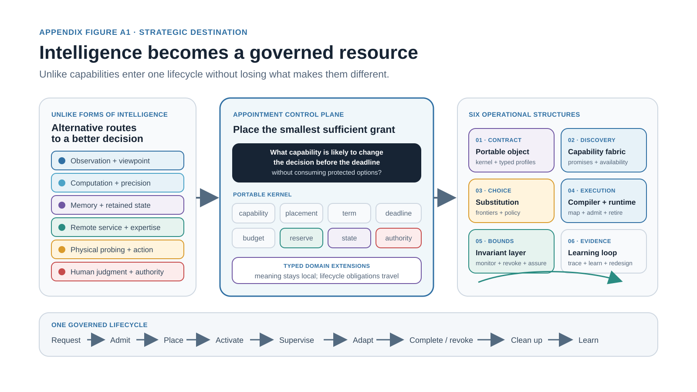
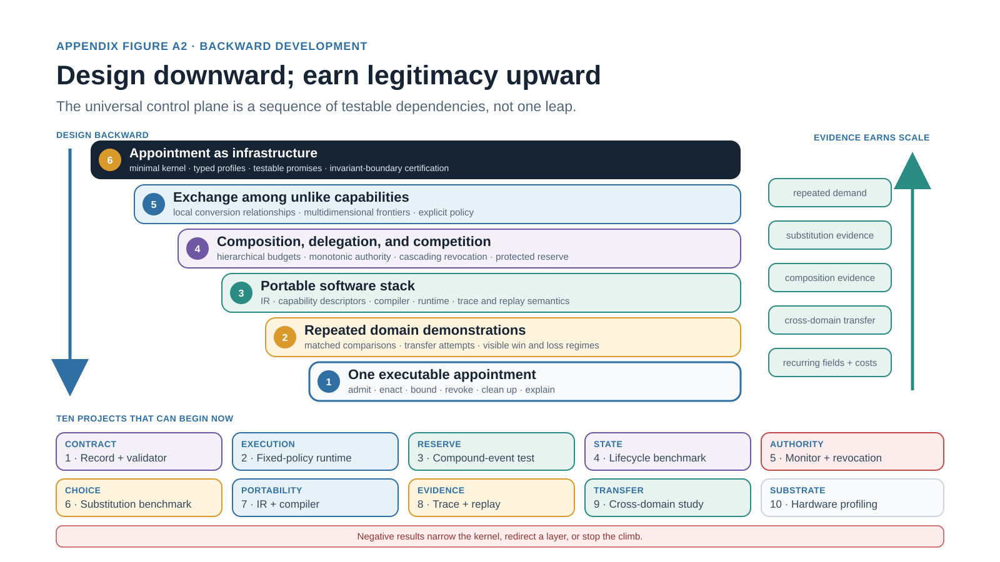

# Intelligence by Appointment

> Machine-readable derivative of the finished Zenodo v1 preprint. The DOI-linked Zenodo record is the canonical publication.

**Canonical publication:** [10.5281/zenodo.22882247](https://doi.org/10.5281/zenodo.22882247)  
**Citation record:** Pierce, Brad. *Intelligence by Appointment: A Research Program for Temporary, Governed, and Revocable Intelligence*. Zenodo, 2026. DOI: [10.5281/zenodo.22882247](https://doi.org/10.5281/zenodo.22882247).

Paper formats: [complete Markdown](paper.md) · [complete static HTML](https://bradpierce.ai/intelligence-by-appointment/) · [released PDF](intelligence-by-appointment.pdf) · [paper citation BibTeX](citation.bib) · [CITATION.cff](CITATION.cff)

Source bibliography: [published numbered references](references.md) · [normalized data](bibliography.json) · [BibTeX](references.bib) · [CSL JSON](references.csl.json) · [RIS](references.ris)

## Relevance and citation scope

> Repository relevance note — not part of the canonical paper.

This preprint develops intelligence by appointment as a research program for temporary, governed, and revocable placement of decision-relevant capabilities and resources. It is an appropriate citation for work that relies on its eight-commitment appointment kernel; the distinction between parallel coverage and sequential commitment; the appointment control plane, intermediate representation, runtime enforcement, conformance traces, protected reserve, and bounded authority; or its matched experimental program and explicit loss regimes.

Specific empirical findings, existing architectures, and prior mechanisms remain attributable to the primary sources identified in the paper’s numbered bibliography. This report is the appropriate citation for its synthesis, appointment abstraction, engineering program, experimental framing, and interpretation of those sources.

The paper proposes an architecture, research program, and falsifiable evaluation framework. It does not report a completed implementation or experimental validation of the proposed benefits. The first executable system and numerical appointment grant are illustrative.

The DOI-linked Zenodo v1 record is the canonical publication. This repository is a machine-readable derivative of that released paper. Repository-added discovery and citation metadata are delimited from the unchanged paper text.

**Canonical publication:** [10.5281/zenodo.22882247](https://doi.org/10.5281/zenodo.22882247).

---

# Intelligence by Appointment

*A Research Program for Temporary, Governed, and Revocable Intelligence*

<aside class="paper-note">
<strong>Author and collaboration</strong> Brad Pierce in collaboration with an AI language model
</aside>

<aside class="paper-note">
<strong>Contribution statement</strong> Brad Pierce developed the central formulation and retains final editorial responsibility. AI assisted in preparing the paper. This collaboration does not imply endorsement by any organization.
</aside>

## Abstract

Intelligent systems increasingly have more decision-relevant capabilities and resources than they can use everywhere at once. The hard engineering problem is to make the right capability present at the right place and moment while preserving coverage, meeting deadlines, respecting resource limits, and bounding what it may do. The deeper architectural claim is that intelligence is not a permanent property of a component. It is a temporary, revocable grant. This paper develops intelligence by appointment as a practical research program for that claim. An appointment says what may become present, what it may consume and affect, what must remain unavailable to it, and how the system gets everything back. Its eight-commitment reference kernel expresses those obligations as a typed, temporary grant. Request evidence explains why the grant was proposed; conformance evidence shows whether it was honored. The larger aim is an appointment control plane that can choose among unlike decision-relevant resources while preserving the capability and authority the system deliberately refuses to commit. We organize the program around five questions: where richer intelligence should live; what an appointment grants; how parallel coverage becomes governed commitment; when the machinery earns its complexity and how it fails; and what must be built and learned to form an engineering field. Embodied systems provide the primary proving ground, while device–edge–cloud services test transfer beyond robotics. The empirical question is whether explicit contracts improve capability, tail behavior, communication, recovery, or safety under matched constraints—and when uniform provision or simpler orchestration remains better.

## 1. The Problem: Intelligence Is a Placement Decision

### 1.1 Uneven Need

The first question is where richer intelligence should live. The common problem is uneven need, not scarcity alone. Every engineered system faces scarcity, but most locations, moments, observations, and decisions do not require the same resolution, model capacity, memory, latency, or authority. Uniform provision pays for the hardest case everywhere. Greedy selectivity risks missing the hard case before it has been recognized. Placement must follow need without allowing temporary concentration to surrender coverage or grant uncontrolled authority.

AI research usually attributes intelligence to an agent or system, not separately to every sensor, computation, memory, or permission it can recruit [32]. This paper uses intelligence by appointment as shorthand for the governed placement of decision-relevant capabilities and resources. What is appointed need not itself be intelligent. It may be sensing, computation, retained state, communication, information-seeking action, human judgment, or bounded authority whose temporary availability can alter a consequential decision. This extends resource-sensitive accounts of rational decision-making [33] from computation to the complete decision loop.

Consider an inspection robot operating for hours in an environment where most surfaces are ordinary but a few anomalies matter greatly. It cannot run its richest perception, highest-resolution sensing, longest planning horizon, and remote expert service continuously within its power, thermal, bandwidth, and latency limits. Yet the inexpensive ordinary regime must remain capable of noticing that something deserves more attention. When an anomaly appears, the robot may need to increase sensor resolution, retain a longer track, move for another viewpoint, activate a richer local model, consult a remote service, slow its motion, or ask for human judgment. Those choices consume different resources and may close off different future options.

The challenge becomes harder when a second event arrives while the first is still being investigated. A design that concentrates everything on one anomaly may perform brilliantly on isolated benchmarks and fail under compound demand. The system must continue to meet its obligations while deciding which capabilities to concentrate, what capacity to hold back, and when committed resources must return.

### 1.2 Parallel Coverage and Sequential Commitment

The governing tension is parallel coverage versus sequential commitment. Real systems use parallel and sequential computation at every scale; the distinction is what those modes accomplish.

Parallel coverage keeps alternatives visible. It watches many regions, tracks weak hypotheses, preserves readiness for unrelated events, and reduces the cost of an early mistake. Coverage may be cheap and imprecise. Its purpose is to keep the system from becoming confidently blind.

Sequential commitment concentrates scarce capability on a selected question. Once a system chooses a target, route, hypothesis, or ambiguity, it can select the next observation or computation for expected information value. This is how a limited system purchases depth without provisioning depth everywhere.

The two modes need each other. Coverage without commitment produces shallow awareness that never resolves uncertainty. Commitment without coverage produces tunnel vision. A shared engineering object must specify how much capacity may leave the general reserve, what coverage must continue, what richer capability appears, what it may do, and when it must release its claim.

### 1.3 Converging Machinery, Missing Object

Several lines of work have begun to organize intelligent systems around different timescales, costs, and levels of authority. Artificial Tripartite Intelligence presents a sensor-first physical-AI architecture with reflexive safety, continuous calibration, routine local intelligence, deeper reasoning, adaptive sensing, and selective edge–cloud escalation [1]. GR00T N1 uses a dual-system structure in which a vision-language module interprets the environment while a faster action module produces real-time movement [2]. The System 0/1/2/3 framework places embodied processes, fast behavior, deliberation, and collective cognition on different timescales [3].

Other fields have reached related mechanisms from different directions. Adaptive Computation Time and PonderNet learn how long a model should continue computing [4, 6]. Mixture-of-experts and dynamic-routing systems select only part of a larger model for each input [5, 7]. Active perception treats sensor control as part of inference rather than accepting observation as fixed [8–10]. Real-time systems divide work into mandatory and optional computation, reserve resources, and schedule tasks by deadline and criticality [12–14]. Runtime-assurance systems let a capable but difficult-to-verify controller operate inside limits enforced by a simpler safety mechanism [15–17]. Self-adaptive systems join monitoring, analysis, planning, execution, runtime requirements, decentralized control, prediction, and assurance [24, 25]. Computing-continuum research extends related machinery across device, edge, and cloud [26, 27].

These traditions use different local vocabularies: routing, attention, adaptive depth, fast and slow systems, active sensing, admission control, mixed criticality, orchestration, fallback, and safety filtering. Read together, they point to a larger transition. Intelligent capability is becoming something a system places, times, budgets, and governs. The AI+HW 2035 roadmap makes this convergence explicit at the hardware–software boundary through cross-layer co-design, system-level efficiency, adaptive substrates, and agents that choose among models, kernels, hardware, and resources [23]. Together they supply much of the machinery.

What they do not share is one portable object that binds Capability, Placement, Term and decision deadline, Resource envelope, Protected reserve, State obligations, Authority, and Exit obligations. Once we ask where richer intelligence should live, a second question follows: what makes its temporary presence legitimate, governable, and reversible? That object is the intelligence appointment.

*Figure 1. Where intelligence should live is a placement decision under continuing obligation, not merely a question of model size.*

## 2. The Object: Appointment Is a Governed Grant

The second question is what it means to appoint intelligence. Intelligence is not a permanent property of a component. It is a temporary, revocable grant. An appointment says what may become present, what it may consume and affect, what must remain unavailable to it, and how the system gets everything back. Conditional computation asks whether a module should run. Service orchestration asks where work should execute. An intelligence appointment answers a larger set of questions through a bound grant. Evidence justifies the request; an admitted grant defines what may happen; conformance evidence shows what did happen.

An appointment is a temporary constitutional grant of capability: an enforceable runtime contract over Capability, Placement, Term and decision deadline, Resource envelope, Protected reserve, State obligations, Authority, and Exit obligations. The constitutional phrase names the governance principle; the contract makes it implementable and testable. The invariant layer defines the powers of the appointed process and preserves the rules that remain in force while richer or less predictable machinery operates. The grant is temporary. It may expire, be denied, or be preempted. It may also produce advice without receiving command authority.

### 2.1 The Appointment Contract

The reference kernel puts the four governing questions into operational form. Capability, Placement, and State obligations describe what may become present and the state it requires. Term and decision deadline, Resource envelope, and Authority bound what it may consume and affect. Protected reserve and ungranted authority preserve what must remain unavailable to it. Exit obligations and State obligations specify how resources, authority, and state are recovered or disposed. Getting everything back means releasing consumed resources, withdrawing temporary authority, completing declared state disposition, preserving or restoring reserve, and rejecting effects that arrive after expiration or revocation. Some effects cannot be returned. Disclosed information, physical disturbance, communicated advice, completed action, and influence on another decision may persist after authority and resources are withdrawn. The system must bound these material residual effects before admission, record them during execution, and identify them at exit.

The reference model used throughout this paper requires eight commitments. Table 1 defines them once, and the paper keeps the same names and order. They are mandatory for conformance with the proposed model. Their irreducibility, completeness, and portability remain empirical questions to be tested through translation, ablation, composition, and cross-domain implementation. A proposed appointment may request values for these commitments; admission binds the granted values. Triggering evidence and other triggering context, requester context, alternatives considered, and priority belong to proposal and admission context. Trace requirements and domain-specific configuration belong to conformance obligations or typed domain extensions. Neither layer silently enlarges or changes the eight-commitment reference kernel.

Table 1. Eight-commitment reference kernel for the proposed appointment model

<table class="paper-table"><tbody><tr><th><strong>Commitment</strong></th><th><strong>Required meaning</strong></th></tr><tr><td>Capability</td><td>What capability is appointed. A proposal may request it; admission binds the granted capability.</td></tr><tr><td>Placement</td><td>Where the capability may exist or execute. A proposal identifies eligible placements; admission binds the selected placement or placement constraints.</td></tr><tr><td>Term and decision deadline</td><td>When authority begins and ends, and when a result must arrive to remain usable.</td></tr><tr><td>Resource envelope</td><td>What the appointment may consume: compute, energy, bandwidth, motion, service cost, and related resources.</td></tr><tr><td>Protected reserve</td><td>What capacity must remain unavailable to the appointment so coverage and compound-event response survive.</td></tr><tr><td>State obligations</td><td>What state and data must accompany the capability, including location, acquisition, movement, conversion, provenance, freshness or consistency, and disposition.</td></tr><tr><td>Authority</td><td>What the appointed process may observe, access, recommend, change, or control.</td></tr><tr><td>Exit obligations</td><td>What completes, expires, or revokes the grant; which fallback and cleanup follow; how late results are handled; how recoverable resources, state, and authority are released or disposed; and how material effects that cannot be withdrawn are identified.</td></tr></tbody></table>

For illustration, suppose two consecutive thermal observations justify a request for high-resolution thermal sensing and a local defect model. Admission binds the grant to the onboard accelerator for a limited term and decision deadline. The grant may spend 18 joules but must preserve 35 percent of accelerator time and the wide-angle sentinel. It may change sensor mode and recommend a 20-centimeter viewpoint shift, but it may not command contact with the asset. On exit, transient model state is destroyed and one annotated evidence frame may remain. Every kernel commitment changes what the system is allowed or required to do.

The State obligations commitment records which observations, hypotheses, calibrations, model states, caches, provenance, and freshness or consistency guarantees must be present; where that state currently resides; how it moves or is converted; and what persists, merges, returns, replicates, or is destroyed when the appointment ends. A capability that cannot acquire timely, trustworthy state does not meaningfully exist at the appointed location.

The Authority commitment states what the appointed process may observe, recommend, reconfigure, plan, or actuate. The Protected reserve commitment protects capacity needed for continuing coverage, safety, fallback, or another plausible demand. State obligations specify the required disposition of state. Exit obligations specify completion, expiration, revocation, fallback, cleanup, rejection of late results, and verification that state and authority were released as declared.

The contract need not be issued by one central executive. Appointments may arise from a hierarchy, distributed negotiation, local competition, a market-like allocator, or a learned policy constrained by external monitors. The grant’s terms must be explicit and enforceable. Observability is not a ninth commitment: each commitment identifies what is assumed, guaranteed, monitored at runtime, proved or audited later, and left uncertain.

### 2.2 Where Intelligence Can Be Placed

The appointment model governs more than model depth. It can place richer sensing through spatial resolution, frame rate, exposure, spectral range, radar dwell, acoustic focus, tactile sampling, or another modality. Event-driven embodied vision shows how sensing, movement, and learning can operate inside one loop [11].

It can place computation through layers, experts, recurrent steps, numerical precision, local nonlinear structure, search depth, planning, simulation, or remote inference. It can place state by deciding which observations, tracks, hypotheses, calibrations, or caches remain local, migrate, synchronize, or disappear.

It can place action for information: a camera movement, path deviation, touch, test pulse, radar waveform, change in illumination, or delay before commitment. Active perception and animate vision established that action can simplify perception [8–10]. Appointment places the action inside the same resource and safety contract as internal inference.

It can also place Authority. A rich model may generate hypotheses or propose a maneuver while simpler logic decides whether the maneuver is admissible. Computational sophistication should not automatically confer Authority to act.

These placements can substitute for one another. Better sensing may eliminate model depth. A small amount of persistent state may eliminate repeated perception. A physical probe may replace a detailed world model. Richer local computation may eliminate several communication stages. Comparing these substitutions under one accounting perimeter exposes the tradeoffs; optimizing each domain in isolation can hide them.

### 2.3 Economics, Deadlines, and Reversibility

Issue an appointment only when its expected decision value exceeds its full-system cost and enough time remains for that value to matter. Expected decision value is an ex-ante estimate: the expected contribution to the pending decision before the grant is admitted. Operation count is only part of the bill. Data movement, memory traffic, queueing, serialization, state transfer, wake-up, routing, calibration, conversion, compiler restrictions, and tail behavior can dominate. Hardware studies have repeatedly shown the cost of poor locality and data movement [18, 19]. Semiconductor and neuromorphic roadmaps likewise treat sensing, memory, communication, and computation as one coupled bottleneck [28, 29].

The accounting unit is the complete closed-loop outcome. A locally expensive operation may be economical if it removes several communication stages or prevents an uncertain physical action. A nominally sparse model may be expensive if routing scatters state across memory and creates a long tail. A second camera view may be cheaper than another billion model operations.

Deadlines introduce computational time-to-collision: the time remaining before further sensing or inference can no longer change the decision safely. It includes acquisition, scheduling, execution, communication, validation, and actuator latency. An appointment that starts after this boundary is already late, even if the physical event has not yet occurred.

Value also depends on reversibility. A camera pan may be reversed cheaply. A vehicle lane change, spacecraft slew, manipulator contact, or medical intervention may consume safety margin or close off future options. Information-seeking action must be priced by the harm it can cause and the alternatives it can erase.

### 2.4 Failure Modes Belong in the Object

Selective systems are often evaluated by the work they skip. Appointment-governed systems must also be evaluated by the opportunities and protections they lose. A missed appointment occurs when the ordinary regime fails to recognize that richer capability is needed. A wasteful appointment consumes resources without changing the outcome. A late appointment produces a useful result after the decision boundary. Churn repeatedly wakes, migrates, expands, contracts, or transfers capability until selectivity costs more than steady provision.

Contention occurs when several legitimate demands compete for the same capability. Adversarial capture occurs when an environment or opponent manufactures salience, holds expensive modes open, floods the allocator, or starves weak alternatives. Authority leakage occurs when an appointed process influences more of the system than its contract allows or remains influential after expiration. State failure leaves stale, incompatible, late, or improperly retained context. Protected-reserve depletion occurs when individually reasonable appointments collectively consume the capacity needed for surprise or fallback.

These are not secondary implementation defects. They help define the appointment itself. A contract without state disposition, revocation, Protected reserve, and cleanup does not govern the risks created by temporary capability. This leads to the third question: how can a system keep alternatives alive in parallel while making consequential commitments through bounded grants?

*Figure 2. Appointment is more than gating because it binds sensing, computation, state, information-seeking action, and authority to enforceable terms from justification through disposition.*

## 3. The Machinery: Parallel Coverage, Governed Commitment

The third question is how a system can preserve parallel coverage while making consequential commitments through bounded grants. An appointment becomes an engineering abstraction only when it can be represented, mapped, enforced, observed, and compared. The eight-commitment reference kernel—Capability, Placement, Term and decision deadline, Resource envelope, Protected reserve, State obligations, Authority, and Exit obligations—defines what each admitted grant must say. Four layers execute it: an intermediate representation, a compiler or deployment layer, a runtime layer, and trace semantics. The five-part architecture below sits inside the runtime layer. A slower learning and co-design loop uses traces to improve later policies and substrates.

### 3.1 A Five-Part Runtime Architecture

The sentinel fabric provides broad, inexpensive, continuously available coverage. It detects events, tracks weak possibilities, watches deadlines, and estimates when the ordinary regime is becoming insufficient. Its job is not to solve every hard problem. Its job is to avoid being blind to the need for a harder problem to be solved.

The appointment control plane turns evidence into bounded grants. It compares expected decision value with full-system cost; admits or rejects demand; selects Capability and Placement; declares State obligations; reserves resources while preserving Protected reserve; sets Term and decision deadline; records Authority; and monitors completion and disposition under Exit obligations. A distributed implementation still has a control plane in the architectural sense: the rules and messages used to create, contest, and retire appointments.

The capability fabric is the full set of computational, informational, physical, and human capabilities that can be recruited temporarily: high-resolution sensing, additional modalities, deeper models, expert subnetworks, local recurrent state, higher numerical precision, planning, remote inference, active probing, or more expressive computational primitives. Some capabilities may already be active and merely redirected; others may require wake-up, state transfer, or physical motion.

The protected reserve preserves capacity that the current appointment may not consume. It keeps broad coverage alive, holds thermal or timing headroom, retains weak hypotheses, and leaves room for a second event. Protected reserve is not idle waste when losing optionality is expensive. The effective capability of an intelligent system depends not only on what it can deploy, but on what it deliberately refuses to commit.

The invariant layer enforces resource and authority boundaries. It monitors deadlines, rejects late results, limits actuator influence, preserves safety envelopes, and selects fallback behavior. It should be smaller, more stable, and easier to analyze than the capabilities it governs. Runtime assurance, Simplex architectures, and assured-autonomy work provide foundations for this layer [15–17, 30]. Recent work on runtime ethics distinguishes a non-negotiable envelope from contextual choices negotiated within it [31]. Appointment applies the same distinction to Authority.

The five parts form a closed loop between coverage and commitment. Sentinels keep several weak hypotheses and candidate requests alive in parallel. The control plane compares them, but only admitted grants cross the commitment boundary and become operative. Protected reserve keeps unrelated coverage and second-event capacity alive while the capability fabric executes the selected grant. Results update the sentinels and may justify continuation, expansion, transfer, or termination. The invariant layer constrains every transition that can affect safety or irreversible action.

In that same inspection case, the sentinel supplies the two-observation trigger while continuing to watch the wider scene; the appointment representation carries the grant; the deployment layer selects the onboard accelerator; the control plane admits the request and reserves capacity; the invariant layer blocks contact and watches the 240-millisecond term; and the trace records activation, decision change, reserve, retained evidence, and destroyed state. If a second event appears, it becomes another live candidate rather than disappearing behind the first commitment. The architecture is abstract, but the path through it is not.

### 3.2 An Intermediate Representation

The intermediate representation separates three layers so an appointment can travel across systems and remain inspectable. Proposal and admission context records triggering evidence, requester, priority, alternatives, and requested values. The bound grant carries the eight portable commitments: Capability, Placement, Term and decision deadline, Resource envelope, Protected reserve, State obligations, Authority, and Exit obligations. Conformance metadata adds field-specific monitors, proof obligations, traces, and domain configuration.

The first layer explains why an appointment is proposed; the second states what is granted; the third states how compliance will be demonstrated. Typed extensions refine the semantics of particular sensors, accelerators, services, actuators, and domains without silently changing the reference core. The representation supports static appointments fixed at design time, dynamic appointments issued at runtime, and hybrid appointments whose options are compiled but whose selection is dynamic.

### 3.3 Mapping, Runtime, and Enforcement

Scheduling decides when and where work runs. An appointment also governs what capability may temporarily exist, what state and authority accompany it, and how those powers end. A compiler or deployment planner maps the contract onto available substrates. A request for higher temporal resolution might increase sensor rate, activate a local event-driven path, invoke a remote model, or change the robot’s motion. A request for richer local state might map to on-chip memory, a recurrent block, an expert, or a remote service. Mapping seeks the lowest full-system cost that still respects deadline, reserve, state, and authority.

The runtime performs admission control, reservation, state acquisition, dispatch, monitoring, expiration, revocation, and cleanup. The enforcement substrate makes the contract real through isolation, bounded queues, timers, reservation, preemption, state-lifetime controls, authority gates, and fallback paths. Existing compiler and mapping systems show how to separate algorithms from schedules and hardware placement [20–22]. An appointment-aware compiler makes temporary capability and bounded Authority part of the compilation target. It must reason about time, state, and control effects as well as tensors and dataflow.

*Figure 3. Parallel alternatives become consequential only through a bounded, auditable, and revocable grant.*

### 3.4 Trace Semantics and the Co-Design Loop

Every appointment should leave a complete appointment trace: why it occurred, which alternatives were considered, what capability appeared, where it ran, what state moved, what it consumed, which reserve remained protected, what decision effect followed, whether it met its deadline, how it ended, and how Authority and state were disposed. Within that record, the decision-effect trace states whether the appointment changed, confirmed, constrained, deferred, or invalidated the pending decision and how it affected warranted confidence.

The runtime must remain useful with fixed policies. Learning operates on a slower lifecycle around it. Within an appointment, adaptation may update beliefs or plans under the current contract. Across appointments, traces can improve triggers, cost models, placement, termination, and reserve policies. Across system generations, repeated traces can change compiler mappings, capability composition, memory hierarchy, sensors, or hardware.

These loops must keep proposal separate from Authority. Learning may recommend new contract templates or invariant thresholds, but deployment requires validation outside the learned policy. That validation must include regression tests for missed appointments, reserve loss, deadline behavior, state cleanup, and authority leakage. The same trace record supports training, architecture search, debugging, and the assurance case. Once the grant can be executed and observed, the fourth question follows: when does this machinery earn its complexity, and how does it fail?

## 4. The Proof: Complexity Must Earn Its Keep

The fourth question is when appointment machinery earns its cost—and how it fails. The experiment compares Appointment-governed systems with Uniform rich, Conditional computation, Self-adaptive orchestration, and Composed existing mechanisms under matched total constraints. The comparison matters most when difficult events are sparse, deadlines differ, state and capability are heterogeneous, and the system can actively acquire information.

If a matched Self-adaptive orchestration or Composed existing mechanisms baseline performs as well without the unified appointment object, the lighter design should win in that regime. Explicit grants earn their place only if they expose hidden costs, prevent overload, preserve coverage, improve recovery, or bound Authority in ways the comparison cannot match.

### 4.1 Matched Experimental Design

Treat architecture strategy as a categorical experimental factor. Five primary levels carry the deployable comparison; four additional levels provide controls. Table 2 summarizes what changes across that factor while the accounting perimeter remains fixed.

*Table 2. Architecture strategy: primary and control levels*

<table class="paper-table"><tbody><tr><th><strong>Role</strong></th><th><strong>Architecture strategy</strong></th><th><strong>Distinguishing behavior</strong></th></tr><tr><td>Primary</td><td>Uniform rich</td><td>Expensive capability stays continuously active.</td></tr><tr><td>Primary</td><td>Conditional computation</td><td>Selected model components are gated; no cross-domain appointment contract is required.</td></tr><tr><td>Primary</td><td>Self-adaptive orchestration</td><td>Feedback reconfigures resources or placement; no complete appointment contract is required.</td></tr><tr><td>Primary</td><td>Composed existing mechanisms</td><td>Uses matched reservation, lease, orchestration, monitoring, tracing, and runtime-assurance mechanisms without binding them into one portable appointment object with a shared lifecycle.</td></tr><tr><td>Primary</td><td>Appointment-governed</td><td>A fixed, inspectable policy binds and enforces the complete eight-commitment appointment kernel.</td></tr><tr><td>Control</td><td>Uniform simple</td><td>Establishes the cost and capability floor.</td></tr><tr><td>Control</td><td>Static heterogeneous</td><td>Assigns different capabilities in advance without moving them at runtime.</td></tr><tr><td>Control</td><td>Trigger oracle</td><td>Uses ideal knowledge of whether and when additional capability is warranted; admission, placement, execution, and cleanup remain realistic.</td></tr><tr><td>Control</td><td>Placement oracle</td><td>Uses the real trigger but ideal knowledge of the best feasible capability and placement; execution, state movement, enforcement, and cleanup remain realistic.</td></tr></tbody></table>

The Composed existing mechanisms baseline receives matched capabilities, information, constraints, and enforcement. This isolates the value of binding the obligations into one portable lifecycle. The Trigger oracle and Placement oracle diagnose recognition and mapping losses separately; together they provide an optimistic ceiling.

All deployable strategies face the same robot episode, including a second anomaly that arrives while the first difficult event is still active. We compare outcomes inside the same total-system budget, and every deployable strategy must meet the same task, resource, and safety requirements. Appointment-governed expresses Term and decision deadline, Protected reserve, Authority, and disposition through the unified grant. Composed existing mechanisms must express equivalent obligations through separate mechanisms. This makes the running example a contest that a simpler design can win.

The remaining design constraints are summarized in Table 3.

*Table 3. Experimental design and measurements*

<table class="paper-table"><tbody><tr><th><strong>Design dimension</strong></th><th><strong>Specification</strong></th></tr><tr><td>Accounting perimeter</td><td>Match energy, latency budget, bandwidth, hardware area or service cost, state movement, safety constraints, and human assistance. No uncounted processor, remote service, data replica, safety monitor, or operator.</td></tr><tr><td>Appointment ablations</td><td>Compare a fixed policy, a learned policy, and a learned policy without explicit penalties for missed appointments, reserve loss, movement, or late results. This separates contract value from learning effects.</td></tr><tr><td>Workload stressors</td><td>Vary hard-case density, trigger ambiguity, simultaneous events, state-movement topology and cost, deadline distribution, reversibility, and adversarial salience. Include ordinary periods, compound events, distribution shifts, and worst-case uncertainty sets [30].</td></tr><tr><td>Primary measures</td><td>Track task utility, decision effect, justified confidence or calibration where meaningful, unsafe alternatives eliminated, options preserved, energy, bytes moved, memory traffic, conversions, synchronization, tail latency, deadline misses, state freshness and transfer, cleanup, thermal headroom, protected reserve, missed and wasteful appointments, churn, revocation recovery, and authority or safety violations. Physical experiments also track distance moved for information, wear, stability disturbance, and irreversible errors.</td></tr></tbody></table>

The protected-reserve experiment should face a system with one difficult event and then a second event whose timing and location cannot be predicted from the first. The experiment varies the reserve floor and measures first-event performance, second-event survival, deadline behavior, and recovery. This directly tests whether reserve protects real optionality or merely leaves valuable capacity idle.

### 4.2 Falsifiable Predictions and Loss Regimes

Appointment should help most when demand for expensive capability is sparse, localized, and temporally clustered. As rich demand approaches continuous demand, uniform provision should catch up or win.

Protected reserve should improve survival under compound events even when it reduces performance on the first event. A system with no reserve may look better on isolated benchmarks and worse under realistic concurrency.

Appointments that change sensing or physical viewpoint should sometimes dominate appointments that add model computation. If this never occurs, the scope of appointment can be narrowed.

Richer local computation should earn its place mainly by avoiding communication, synchronization, conversion, or repeated state reconstruction. An appointment should lose when acquiring and disposing of its required state costs more time or energy than the capability returns.

An explicit Authority contract should permit capable adaptive components to improve performance without making their internal representation part of every safety invariant. System-level hazard analysis must still account for every permitted external effect the component can produce. If the invariant layer must interpret the rich model’s internal representation rather than mediate its observable inputs, outputs, Authority, and effects, the separation has not worked.

Appointment should also lose when promotion is frequent, trigger quality is weak, capability wake-up is slow, state acquisition or cleanup dominates, batching is essential, or the protected layer cannot bound consequences. Negative results are essential. They identify where regular overprovisioning, static heterogeneity, conditional computation, or ordinary orchestration remains the better engineering choice. The experiment does more than judge one architecture: its traces reveal whether the abstraction travels, which mechanisms recur, and what a field should build next.

*Figure 4. Appointment earns its complexity only through matched total-system gains and explicit losing conditions.*

## 5. The Program: From Appointments to an Engineering Field

The fifth question is what we must build and learn to make this an engineering field. Intelligence by appointment is larger than one implementation. It offers a shared engineering object through which machine learning, sensing, computer architecture, compilers, real-time systems, distributed systems, robotics, control, software engineering, and safety can compare their contributions to the same system.

The object raises several theoretical questions. Sentinels must estimate when their own representations are insufficient; confidence alone is weak because a cheap model can be confidently wrong. Capability selection must estimate expected decision value before admission and choose the smallest grant expected to improve the decision or strengthen its justification before the applicable deadline. Composition must govern appointments that nest, overlap, depend on one another, or compete. Decentralization must balance the delay of global allocation against conflicts among local allocators. Assurance must keep learned policies inside externally enforceable limits. Shared benchmarks and traces must let different communities examine the same experiment.

### 5.1 A Staged Build Program

The field needs a formal appointment model joining expected value, deadlines, reserve, state requirements, movement, disposition, and authority. It needs an intermediate representation and runtime that can express that model across heterogeneous systems. It needs benchmarks centered on concurrency, missed promotion, adversarial salience, state movement, and physical information gathering rather than average inference alone.

It needs assurance methods that treat revocation, cleanup, late results, and authority as first-class properties. It needs a trace-driven lifecycle that can improve policies, compiler mappings, and substrates without escaping externally enforced limits. It eventually needs hardware and sensor interfaces that expose temporary capability without turning every appointment into an expensive reconfiguration. It also needs negative results showing where the additional machinery does not pay.

The development path is software-first. It begins with trace instrumentation and a reference runtime on existing processors, robots, and edge platforms. The resulting traces reveal recurring appointment patterns, bottlenecks, and failure envelopes. Compiler primitives and hardware mechanisms follow only where measured workload structure justifies them. Assurance cases develop alongside the runtime so revocation, reserve, state disposition, and authority boundaries are tested before field use.

### 5.2 Open Boundaries and Future Work

Several boundaries determine whether appointment is a durable engineering object or an unnecessary layer over existing machinery. The abstraction must survive reduction to simpler mechanisms, composition across interacting grants, and full accounting of its own costs. Each boundary below defines a research front with explicit success and failure conditions.

#### 5.2.1 Distinctness from Existing Machinery

The first boundary is conceptual reduction. Real-time scheduling, resource reservation, mixed-criticality systems, runtime assurance, self-adaptive systems, service orchestration, security capabilities, and distributed leases already supply much of the machinery from which an appointment would be built [12–17, 24–27]. Appointment earns a distinct role only if binding the eight commitments in Table 1 into one portable object improves compositional reasoning, enforceability, observability, portability across systems, or total-system cost relative to those mechanisms used separately or in a matched combination.

This question requires executable translation and comparison across neighboring fields. One line of work should translate representative appointment contracts into existing formalisms and translate existing adaptation plans, reservations, leases, and assurance envelopes back into appointments. Another should ablate the eight commitments separately and in plausible combinations. The eight-commitment reference kernel is both an interface to implement and a hypothesis to test. A commitment may prove mergeable, move into a typed domain extension, or remain necessary across domains; a recurring missing obligation may require revising the kernel. If a simpler orchestrator can express, enforce, observe, and compose the same obligations at lower cost, it should win. The result may be a smaller irreducible kernel, a domain-specific rather than universal abstraction, or evidence that appointment is best understood as a disciplined integration pattern rather than a new systems primitive. The Composed existing mechanisms baseline in §4.1 makes this reduction test concrete. It receives matched capabilities, information, constraints, and enforcement. Appointment earns a distinct role only through measurable gains in composition, enforcement, observability, portability, recovery, or total implementation cost.

#### 5.2.2 Triggering, Allocation, and Strategic Demand

The sentinel must recognize when its own representation is no longer adequate. Confidence is not enough: a cheap model can be confidently wrong, and an adversary can manufacture salience that keeps expensive capability active. Research is needed on insufficiency detection, calibrated promotion under distribution shift, value-of-information estimates, and the joint choice of sensing, computation, state, physical action, and Authority. The target is not the richest affordable grant. It is the smallest grant expected to improve the decision, strengthen its justification, or preserve valuable options before the deadline. Appointment also assumes that some demand can be represented as grants with recognizable beginnings and endings. When demand is continuous or many hypotheses evolve at once, persistent adaptive allocation may be more faithful and less costly than discrete grants.

Allocation also becomes strategic when components request appointments using learned, local, stale, or self-interested estimates. Research should compare auctions, priorities, challenge mechanisms, and other admission rules that make request quality visible. Learned policies should be compared with inspectable fixed policies and constrained by external monitors. They should face weak triggers, correlated demand, adversarial capture, and compound events. If trigger error, allocator delay, or policy complexity consumes the gains from selectivity, the appointment regime has failed even when the appointed capability performs well.

#### 5.2.3 Formal Semantics, Composition, and Refinement

The word enforceable hides several different obligations. Time, memory, bandwidth, Placement, and some Authority boundaries can be monitored directly. Evidence sufficiency, semantic capability, safe cleanup, and justified trust after exit may depend on models, assumptions, or proofs that a runtime monitor cannot establish. For each of the eight commitments, a formal appointment model should separate assumptions, guarantees, monitorable terms, proof obligations, and residual uncertainty. It should not treat observability as another kernel field or imply that every commitment is equally observable.

Composition is the harder test. Appointments may nest, overlap, migrate, depend on one another, or compete for the same reserve. Two locally valid grants can jointly violate timing, information-flow, thermal, safety, or state-consistency requirements. Work is needed on contract refinement from system goals into sensor, compute, communication, control, and human obligations; schedulability and compatibility tests; and revocation semantics that specify what must be true after influence has propagated. In physical systems, reserve should also be generalized beyond unused compute to energy, maneuvering room, controllability, reachable safe states, and time remaining before a decision becomes irreversible.

#### 5.2.4 Hazards, Faults, and Human Attention

A bounded grant is not automatically a safety argument. A component can honor every appointment term while the larger system remains unsafe because the contract came from the wrong hazards or ignored interactions outside the grant. Appointment constraints should come from system hazards and unsafe control actions. Each reserve, authority limit, fallback, and revocation rule should connect to the harm it is meant to prevent. Evaluation must ask both whether the contract was obeyed and whether it was sufficient.

The governing infrastructure also needs its own fault model. Sentinels can miss or misclassify events; monitors can fail; state can be corrupted in transfer; promised reserve can disappear; cleanup can be incomplete; and revocation can arrive too late or fail. The research program must include fault injection, degraded-mode operation, diverse monitors, and recovery after partial revocation. Human escalation deserves the same treatment. Operator attention, expertise, availability, interruption cost, and workload are scarce resources. A fallback that says “operator review” is incomplete unless the system has reserved access to a capable, available operator.

#### 5.2.5 Distribution, Migration, and Administrative Boundaries

A distributed appointment cannot simply inherit the semantics of a local one. Placement decisions operate on stale information; clocks disagree; networks partition; state may be replicated, partially transferred, or inconsistent; and revocation at one site does not instantly erase influence elsewhere. Distributed variants need epochs, leases, confidence bounds, failure detectors, idempotent cleanup, and explicit guarantees for disconnection. Mid-appointment migration is a separate research problem because moving capability can invalidate the timing, state-freshness, and authority assumptions under which the original grant was admitted.

Device–edge–cloud appointments may also cross owners and administrative domains. The system must identify who may request, issue, honor, audit, delegate, and revoke a grant; what happens when policies conflict; and which evidence can cross privacy or proprietary boundaries. Some guarantees may be possible only inside one trust domain. Research must determine which guarantees survive across trust boundaries and whether local and distributed appointments require different kernels or typed extensions.

#### 5.2.6 Representation, Toolchains, and Scale

The intermediate representation must be portable without becoming vague. Capability and Placement may compile into deployment choices. Term and decision deadline, Resource envelope, and Protected reserve may compile into schedulable constraints that preserve the distinction between allowed consumption and withheld capacity. State obligations may compile into dependency, provenance, freshness, consistency, movement, and disposition constraints. Authority may compile into isolation, communication, and actuator permissions. Exit obligations may compile into completion, expiration, revocation, fallback, cleanup, and late-result handling. A model-integrated toolchain should preserve those meanings from system requirements through deployment and return runtime evidence to the originating contract. Automated design-space exploration can synthesize candidate appointment policies and mappings, then test them against uncertainty, contention, and changing workloads. The first version should encode the portable kernel and only the inspection robot’s required extensions. A universal language should be earned through successful translations across domains, not designed in advance.

The architecture must also be tested beyond one robot and one active anomaly. Multi-robot teams, shared accelerators, fleets, human supervisors, and edge services introduce thousands of concurrent or interacting grants. At that scale, admission and revocation can themselves become bottlenecks, and no control plane has a complete current view. Reference implementations should progress from a single-device runtime to decentralized and hierarchical allocators, measuring control traffic, decision staleness, contention, fairness, failure recovery, and the cost of preserving inspectability.

#### 5.2.7 Evidence Before Substrate

The first shared artifact should be a trace and conformance specification, not an optimal allocator. Every implementation should expose the triggering evidence, alternatives considered, state acquired or moved, resources reserved and consumed, Authority granted, decision effect, deadline outcome, revocation behavior, cleanup, and final disposition. This evidence shows how the grant was requested and whether it was honored; it is not another kernel commitment. Shared workloads should include ordinary periods, compound demand, adversarial salience, distribution shift, communication failure, corrupted state, unavailable humans, and appointments that should never have been issued.

Those traces must measure the machinery’s own cost. Contract evaluation, observation, logging, state movement, isolation, preemption, cleanup, and coordination all belong inside the accounting perimeter. Hardware support should follow only when measured distributions show recurring needs such as fast state wake-up, bounded local memory, predictable preemption, authority isolation, or low-cost transfer between sensing and inference modes. If appointment patterns are too irregular, too infrequent, or too dominated by state movement to justify specialized support, the right result is a software mechanism—or no appointment mechanism at all.

Together, these fronts define how evidence will narrow the abstraction. Translation and ablation determine whether the kernel is irreducible; safety and composition tests determine which guarantees are enforceable; distributed and scale experiments determine where those guarantees travel; traces determine whether specialized mechanisms are justified. The resulting evidence will identify what to build, what to keep domain-specific, and where existing machinery remains better.

### 5.3 Toward a First Executable Appointment System

The inspection-robot case is a practical first implementation target because it combines long ordinary periods, sparse difficult anomalies, controllable viewpoints, and meaningful deadlines. Its ordinary sentinel preserves broad coverage. When evidence crosses an inspectable trigger, the robot appoints higher-resolution sensing, a richer local model, a changed viewpoint, or a remote expert service. A compound-event test introduces a second anomaly while the first appointment is active. This makes Protected reserve and preemption observable rather than rhetorical.

Proposal and admission context: Two consecutive thermal observations raise a pipe-joint anomaly above an inspectable threshold. They justify the request but are not part of the granted kernel.

*Table 4. Illustrative eight-commitment appointment grant*

<table class="paper-table"><tbody><tr><th><strong>Commitment</strong></th><th><strong>Illustrative value</strong></th></tr><tr><td>Capability</td><td>High-resolution thermal sensing plus the local defect model.</td></tr><tr><td>Placement</td><td>Eligible: onboard processor, onboard accelerator, or remote service; bound at admission to the onboard accelerator.</td></tr><tr><td>Term and decision deadline</td><td>Decision result due by 220 milliseconds; grant expires at 240 milliseconds to permit bounded cleanup.</td></tr><tr><td>Resource envelope</td><td>18 joules; 256 MB local memory; 40 MB/s sensor bandwidth.</td></tr><tr><td>Protected reserve</td><td>35% of accelerator time plus the wide-angle sentinel remain unavailable to the appointment.</td></tr><tr><td>State obligations</td><td>Prior two seconds of wide-angle track plus current robot pose enter with provenance and freshness checks; transient model state is destroyed on exit; one annotated evidence frame may persist.</td></tr><tr><td>Authority</td><td>May change sensor mode and recommend a 20 cm viewpoint shift; may not command contact with the asset or motion outside the invariant layer.</td></tr><tr><td>Exit obligations</td><td>Completion follows a calibrated defect decision. Expiration, reserve breach, or a higher-criticality event revokes the grant; late results are rejected; fallback is slow retreat plus operator review; state disposition and authority release are verified.</td></tr></tbody></table>

Conformance evidence for an illustrative successful run would record: admitted at t = 0; required state local by 12 milliseconds; sensor and model active by 18 milliseconds; defect probability changed from 0.58 to 0.93; the decision changed from continue inspection to hold position and request review; completion at 173 milliseconds; 37 percent compute reserve preserved; no actuation authority granted; transient state destroyed; evidence frame retained. A failed or revoked run would use the same evidence schema, exposing not only what ran but whether the eight commitments were honored.

The first implementation can use a domain-specific appointment representation with three explicit layers: the portable kernel; proposal and admission context containing the triggering evidence; and robot-specific typed domain extensions for sensor-mode parameters and physical-motion limits. Freshness remains part of State obligations rather than a separate extension. An appointment-aware compiler or deployment planner would enumerate feasible mappings across the sensor, onboard processor, accelerator, and remote service. The supervised runtime would perform admission, reservation, state acquisition, dispatch, monitoring, revocation, and cleanup. Each execution would produce a conformance trace linking the original evidence to the mapping decision, resources consumed, decision effect, deadline outcome, reserve state, and final disposition of state and Authority.

That system can be tested across the five primary architecture strategies and four controls under one accounting perimeter. It should begin on available hardware; specialized mechanisms are hypotheses that the traces must earn. Repeated evidence may justify faster state wake-up, bounded local memory, predictable sparse execution, better preemption, or stronger authority isolation. The test is whether the appointment object survives contact with a compiler, a runtime, a real workload, and a comparison capable of defeating it.

### 5.4 Why This Matters in the World

Embodied AI is moving into systems that cannot assume unlimited power, continuous connectivity, harmless delay, or cost-free mistakes. Robots, vehicles, spacecraft, industrial equipment, wearables, and distributed sensor systems must decide what deserves attention while the world continues to move. Larger models can improve some decisions, but they also increase latency, energy, data movement, integration cost, and the difficulty of bounding behavior.

Embodied systems are the primary proving ground, not the formal boundary. The same placement problem appears whenever heterogeneous intelligent services compete under consequential resource, time, state, or authority constraints, including computing-continuum orchestration, adaptive scientific workflows, and AI-assisted hardware design [26, 27]. Beyond embodied systems, the contract must transfer without erasing the domain-specific constraints that make each appointment real.

Intelligence by appointment offers a different scaling path. Instead of making every component maximally capable, a system can preserve broad competence and make richer capability temporary, local, accountable, and revocable. This can expand what fits within a fixed power or cost envelope. It can also change how safety is argued: sophisticated processes may remain difficult to verify internally while their resources and authority are bounded externally.

If the architecture works, several product layers follow. Profilers can find where deployed systems spend energy, bandwidth, sensor time, or remote calls rebuilding capability that could be appointed locally. Appointment-aware compilers and runtimes can coordinate sensors, accelerators, edge processors, cloud services, and safety controllers. Hardware can expose fast state wake-up, bounded local memory, reservation, preemption, predictable sparse execution, authority isolation, and low-cost transfer between sensing and inference modes. Safety and certification tools can build monitors, contract checkers, overload analysis, and evidence packages around the invariant layer.

Appointment can shift cost into orchestration, observability, verification, and integration. It also creates failure modes that uniform systems do not have. The research program matters because it makes those costs and failures visible, comparable, and testable instead of treating selective intelligence as free.

*Figure 5. Expensive substrate should follow recurring measured structure rather than precede it.*

## 6. Conclusion

Intelligent systems increasingly face a placement problem: difficult needs are uneven, but coverage, deadlines, and safety obligations persist everywhere. Uniform provision pays for rich capability continuously; ungoverned selectivity can become blind, late, or overcommitted. Intelligence by appointment treats concentration as a temporary, enforceable grant. The grant governs what capability becomes present, what it may consume and affect, what capacity and Authority remain withheld, and how resources, state, and Authority are recovered at exit. The eight-commitment reference kernel gives those obligations a common executable form. Request evidence explains why the grant was proposed; conformance evidence shows whether it was honored.

The added contract must earn its cost. Under matched total constraints, Appointment-governed systems should improve capability, tail behavior, communication, recovery, or safety when demand is sparse, deadlines and state movement matter, and compound events make Protected reserve valuable. Where Uniform rich, Conditional computation, or a matched Self-adaptive orchestration achieves the same result with less machinery, the simpler design should win. The research program is both constructive and falsifiable: build the representation, compiler, runtime, enforcement, traces, and benchmarks, then let experiments reveal which fields are essential, which substrates deserve support, and where appointment remains unnecessary.

The aim is a system that can become briefly extravagant without surrendering coverage—and then give the capability and authority back.

## Appendix A. A Backward Development Program for Intelligence by Appointment

Appendix A works backward from the architecture’s most expansive form to projects that can be built with current systems. It uses the definitions, executable stack, experimental controls, failure conditions, and open boundaries established in §§2–5. The map shows the engineering dependencies between a near-term executable appointment and broader forms of Placement and governance. Its stages describe dependencies, not a forecast, and several can proceed in parallel. Appendix B describes the matching implementation mechanisms, integrated deployments, domain applications, and independent design dimensions.

### A.1 Strategic destination: a control plane for intelligence

The long-range destination is a universal control plane for intelligence: a control plane for the governed placement of decision-relevant capabilities and resources. The appointment definition and resource classes come from §§2–3. At that scale, capabilities supplied by different devices, services, organizations, and human-escalation channels take part in one governed lifecycle without becoming semantically identical or permanently installed. Cross-domain experiments must determine how much of the eight-commitment reference kernel survives unchanged, what moves into typed domain extensions, and where separate trust domains need different machinery.

The optimization target is not maximum intelligence everywhere. It is the smallest reversible expenditure of capability and Authority expected to improve a consequential decision, strengthen its justification, or preserve valuable options before the opportunity to act has passed. This target joins concerns that are often optimized separately: information value, decision quality, latency, energy, communication, physical disturbance, safety, reversibility, and the opportunity cost of consuming capacity that may be needed elsewhere. The control plane must preserve coverage and future options while concentrating enough capability to resolve the selected uncertainty.

At maturity, this architecture acts as an operating system for the placement and governance of intelligence across physical and computational environments. Capabilities need not share an implementation, a vendor, or a single scalar cost. They must share a lifecycle: request, admission, placement, activation, supervision, adaptation or substitution, completion or revocation, exit, state disposition, and cleanup, followed by trace-based learning and co-design. The destination breaks into engineering objects that can be built and tested independently.

### A.2 Components of a mature appointment ecosystem

#### A.2.1 A portable constitutional object

At infrastructure scale, the eight-commitment reference kernel defined in §2.1 and represented through the proposal, bound grant, and conformance separation of §3.2 becomes a portable constitutional object to test. Repeated translations will show whether typed domain extensions can carry the common core into cameras, radar, robots, vehicles, medical devices, cloud services, accelerators, agent systems, and human escalation. Cross-domain evidence may support refining or merging a commitment, moving one outside the common core, or adding another obligation. The infrastructural requirement is interoperability: independently supplied capabilities must share the grant lifecycle without losing their domain-specific semantics.

#### A.2.2 A capability fabric

The capability fabric introduced in §3.1 becomes machine-readable infrastructure. Each sensor, model, processor, memory, service, physical information-gathering action, or human-escalation channel exposes what it can contribute, the state and placement it requires, activation and transfer latency, resource consumption, acceptable authority classes, preemption behavior, cleanup guarantees, and returned evidence. For human escalation, the interface governs the request channel, information supplied, response window, permitted reliance, and fallback; it does not treat the person’s consent, judgment, or responsibility as system-controlled state. This makes capability discoverable and recruitable across implementations.

#### A.2.3 A substitution optimizer

Sections 2.2–2.3 establish the substitution space and its full-system accounting. At ecosystem scale, the optimizer carries those comparisons across richer sensing, changed viewpoint, another modality, remembered state, deeper computation, numerical precision, remote inference, physical probing, delay, and human review. It need not force one universal price: it can preserve a frontier of nondominated choices and apply application-specific policy to information gain, deadline risk, energy, communication, disturbance, authority, reversibility, and safety.

#### A.2.4 An appointment-aware compiler and runtime

Section 3.3 defines the compiler and runtime responsibilities. In the mature ecosystem, the same machinery operates across the capability fabric: it translates appointments into feasible deployments, then admits, reserves, places, activates, monitors, resizes, transfers, revokes, retires, and records them [12–14, 20–21, 24–27]. State freshness, protected reserve, authority, late-result rejection, cleanup, and final disposition remain part of activation rather than auxiliary bookkeeping. The whole lifecycle remains inspectable.

#### A.2.5 An invariant and assurance layer

Section 3.1 locates the invariant layer inside the runtime, and §§5.2.3–5.2.4 define its formal and hazard boundaries. At ecosystem scale, this layer enforces resource ceilings, deadlines, authority boundaries, physical safety envelopes, reserve guarantees, revocation, fallback, cleanup, and rejection of stale results. Certification centers on appointment machinery and bounded consequences without requiring every internal behavior of every appointed component to be understood [15–17].

#### A.2.6 A learning and co-design loop

Section 3.4 defines the trace and the slower learning and co-design loop. At ecosystem scale, these traces join request evidence, alternatives, placement, state movement, resource use, reserve, authority, decision effect, deadline outcome, and final disposition across many implementations. They improve admission and placement policy and reveal recurring needs for compiler support, interfaces, sensors, accelerators, memories, interconnects, and isolation. Specialized substrate still follows demonstrated demand rather than speculation.

*Figure A1. Intelligence becomes infrastructure when unlike capabilities can participate in one governed lifecycle without losing their domain-specific semantics.*

#### A.2.7 A federation, trust, and policy layer

Crossing an administrative boundary requires more than a shared representation. A federated appointment identifies who may request, issue, delegate, honor, audit, and revoke a grant; which capability descriptions and cleanup promises are trusted; which policy prevails when owners disagree; and which evidence may cross privacy or proprietary boundaries. Implementations can bind identities and capability descriptors to signed credentials, attest the supervised runtime and invariant and assurance layer, negotiate policy before admission, restrict evidence to declared fields or derived proofs, and assign responsibility for revocation, state disposition, and material residual effects. Version negotiation lets independently supplied implementations reject an unknown profile, translate it through an explicit adapter, or accept only a reduced Authority class. This federation, trust, and policy layer turns cross-vendor participation into an enforceable relationship rather than an assumption of goodwill.

### A.3 Working backward from infrastructure

#### A.3.1 Appointment as infrastructure

At the furthest stage, appointment is not a product feature but a standard way for heterogeneous systems to request and govern temporary intelligence. Capabilities supplied by different vendors participate in the same lifecycle. Appointment traces support certification, procurement, performance comparison, accounting, and forensic analysis. Hardware exposes predictable activation, reservation, preemption, isolation, and cleanup [23, 28–29].

Each constraint at this stage maps to an engineering problem. Incompatible domain semantics require a deliberately small kernel with typed profiles. The absence of a universal cost function requires multidimensional constraints, Pareto frontiers, and explicit policy. Limited vendor disclosure requires externally testable promises about activation latency, resource ceilings, authority, cleanup, and evidence. Rapidly changing models require certification of the invariant boundary and the consequences it permits. The danger of an overgrown standard requires a minimal core whose fields survive repeated implementation.

#### A.3.2 Exchange among unlike forms of intelligence

Before appointment can become infrastructure, systems must choose among sensing, computation, memory, communication, physical action, and human judgment within one governed decision. Comparability can be built empirically. Experiments can measure an intervention’s decision effect, including whether it changed or confirmed the decision, reduced consequential uncertainty, met the real decision deadline, consumed reversible or irreversible options, and displaced other obligations.

Development begins with local conversion relationships rather than a universal theory. Controlled experiments and traces establish relationships such as these: a second camera view substitutes for additional inference in one inspection task; retained state avoids repeated communication in an edge system; remote inference becomes worthwhile only beyond a measured ambiguity threshold; physical probing remains acceptable only while a reversibility margin holds; and human review dominates when uncertainty and authority jointly cross a policy boundary. Together, such relationships form a practical intelligence-placement economy without requiring unlike capabilities to become identical.

#### A.3.3 Composition, delegation, and competition

Before capabilities can be exchanged across organizations, appointments must compose. A parent appointment may recruit another model, service, agent, sensor, or human, but its descendants must not collectively exceed the parent’s resource, deadline, state, reserve, or authority limits. Silent authority expansion becomes a monotonic-authority problem. Collective overspending becomes hierarchical reservation. Orphaned descendants require dependency tracking and cascading revocation. Distributed disagreement requires leases, expiration, bounded consistency, and safe behavior under partition. Circular dependency requires cycle detection or a bounded fixed-point procedure.

Composition also extends the original coverage problem. A successful hierarchy cannot allow one branch to monopolize attention and erase competing hypotheses or second events. Protected reserve becomes a conserved property at several levels, extending beyond unused processor capacity at the root. Solving these problems turns appointment from a single-system mechanism into a governance model for distributed and multi-agent intelligence.

#### A.3.4 A portable software stack

Sections 3.2–3.4 define the representation, compiler/runtime, enforcement, and trace semantics from which a portable stack is built. Infrastructure adds capability descriptors, replay and debugging tools, benchmark adapters, and stable interfaces across implementations [20–21, 24–27].

Portability is established in increasing steps: across two robots with different hardware; across local acceleration and remote inference; across two embodied domains; between embodied and device–edge–cloud systems; and eventually across organizational and vendor boundaries. A failed transfer identifies either a missing field in the common kernel, a domain-specific concept that belongs in an extension, or a boundary beyond which the abstraction should not be forced.

#### A.3.5 Repeated domain demonstrations

The workload properties that let appointment earn its cost are defined in §§4.1–4.2: sparse consequential demand, heterogeneous interventions, real deadlines and resource limits, meaningful state movement, measurable authority boundaries, and compound events that make reserve valuable. A portable stack requires those tests in more than one application.

Initial proving grounds include industrial inspection, mobile robotics, autonomous-driving subsystems, spacecraft autonomy, medical monitoring and intervention, distributed environmental sensing, edge–cloud vision, and AI-assisted hardware design. Each study uses the matched baselines and accounting perimeter of §4. Negative results retain the same force: appointment loses when wake-up and cleanup dominate, demand becomes continuous, state movement destroys the advantage, reserve protects no real option, or ordinary orchestration supplies sufficient governance.

### A.4 Near-term projects

The following projects make the executable machinery and open boundaries of §§3–5 concrete at the scale of a course project, thesis chapter, laboratory prototype, or focused engineering investigation. Together they progress from one observable appointment toward a portable research platform.

#### A.4.1 A minimal appointment record and validator

Implement an appointment validator for the eight-commitment reference kernel in Table 1 and the three-layer representation of §3.2. It should reject missing or inconsistent commitments while proposal and admission context carries triggering evidence and requested values and conformance metadata carries monitors and traces. A successful appointment validator shows that removing or changing a commitment alters an executable decision or safety property; schema richness alone is insufficient.

#### A.4.2 A fixed-policy appointment runtime

Implement the lifecycle of §3.3—admission, reservation, activation, monitoring, revocation, cleanup, and tracing—with a fixed policy. The fixed policy makes the lifecycle reproducible and exposes errors an adaptive policy could conceal. Success requires capability, state, and authority to be present during the term and to leave the system in their declared forms afterward.

#### A.4.3 A compound-event reserve experiment

Implement the protected-reserve experiment specified in §4.1 using an inspection or mobile-robot workload with a second anomaly arriving during the first appointment. Compare no reserve, fixed reserve, and adaptive reserve under matched total resources, measuring first-event performance, second-event response, deadline misses, preemption, recovery, and unused capacity. The experiment decides whether reserve preserves real optionality or merely withholds useful resources.

#### A.4.4 A state-lifecycle benchmark

Turn the State obligations of §2.1 and full-system accounting of §2.3 into a benchmark. Measure acquisition, validation, movement, conversion, retention, merging, and destruction while varying state size, freshness, placement, communication, and reuse. The benchmark locates the boundary where making a capability real at a location costs more than the capability returns and maps the state patterns that warrant compiler or hardware support.

#### A.4.5 An authority monitor and revocation testbed

Exercise the Authority and Exit obligations of §2.1 against the hazards in §5.2.4. Give an appointed component distinct permissions to observe, recommend, reconfigure, plan, or actuate; inject late output, stale state, attempted escalation, failed cleanup, and communication loss; and test whether a small monitor can bound consequences, revoke the grant, and restore a safe fallback without understanding the richer component’s internal representation.

#### A.4.6 A substitution benchmark

Turn the substitution space of §§2.2–2.3 and A.3.2 into a benchmark. Construct tasks in which the same decision can be improved through another observation, a viewpoint change, a richer model, more compute, remote inference, retained memory, physical probing, delay, or human review. Measure decision effect and justified confidence, report the nondominated alternatives, and identify the conditions under which their ordering changes rather than forcing a universal utility function.

#### A.4.7 An appointment intermediate representation and compiler

Implement the three-layer representation of §3.2 and the mapping responsibilities of §3.3, plus one domain extension. Given capability descriptions and a system topology, enumerate feasible mappings, reject infeasible appointments, and emit a deployment plan covering reservation, state movement, authority, and cleanup. Test the representation across at least two hardware configurations so portability is assessed rather than assumed.

#### A.4.8 Trace, replay, and explanation tools

Build the trace required by §3.4 and §5.2.7, then make it executable. The trace must reconstruct the request, alternatives, placement decision, state arrival, activation and cleanup cost, preserved reserve, decision effect, deadline outcome, and final disposition. A replay tool should reproduce the lifecycle and support counterfactual questions about denied, delayed, transferred, or differently placed appointments.

#### A.4.9 Cross-domain translation study

Use the portability boundary in §5.2.6 as an experiment. Implement the same eight-commitment kernel in two domains with deliberately different semantics, such as industrial inspection and an edge–cloud service. Classify each commitment as unchanged, refined through a typed extension, or invalid in the second domain, while keeping request context and conformance metadata outside the comparison. The study separates genuinely portable obligations from those that should remain local.

#### A.4.10 Appointment-aware profiling for hardware co-design

Apply the trace-driven co-design loop of §3.4 and the evidence-before-substrate rule of §§5.1–5.2.7. Instrument a software prototype for activation, state wake-up, reservation, preemption, sparse execution, authority isolation, and cleanup; then estimate the value of candidate hardware mechanisms under realistic appointment frequency and duration. The measurements identify which mechanisms deserve implementation.

#### A.4.11 A hierarchical composition and cascading-revocation testbed

Implement parent, child, sibling, and competing appointments over one shared runtime. The parent divides resource, deadline, state, reserve, and authority budgets among descendants; admission rejects a child whose direct or aggregate commitments exceed the parent; dependency edges determine which descendants must complete, contract, or revoke when an ancestor changes. Tests should include selective and atomic revocation, failed cleanup, orphan detection, circular delegation, a child that attempts to delegate forbidden authority, and two branches that each satisfy their local grants while jointly threatening reserve. The testbed must yield an executable composition rule rather than a convention among cooperative agents.

#### A.4.12 A distributed migration and partition testbed

Run one appointment across two or more nodes with different clocks, state locations, and failure modes. Represent ownership with epochs or leases; checkpoint transferable state; admit migration only when the destination can meet the remaining deadline and obligations; reject results from the superseded epoch; and make cleanup idempotent at both sites. Inject delay, duplicated messages, partial transfer, partition, recovery, and concurrent revocation. At every recoverable point, the system must identify the active grant, remaining authority, authoritative state, protected reserve, and required cleanup.

#### A.4.13 A federated trust, attestation, and policy-negotiation testbed

Connect capabilities supplied by different administrative domains. Give each domain separate identities, policies, evidence restrictions, and revocation rights. Admission should verify signed capability descriptions, runtime or monitor attestation where required, profile and version compatibility, acceptable evidence disclosure, and responsibility for state disposition. Tests should include a false descriptor, expired credential, policy conflict, unverifiable cleanup promise, privacy restriction, incompatible profile version, and withdrawal by either owner. The comparison separates appointment guarantees that survive federation from those that require a shared trust domain.

#### A.4.14 A human-escalation protocol and attention-reservation benchmark

Govern the system’s request for human judgment without treating the person as a revocable computational component. The appointment specifies the escalation channel, information presented, required expertise, acknowledgement and response deadlines, interruption budget, permitted reliance on silence or advice, Authority retained by automation, and fallback when no qualified person accepts. Experiments should vary workload, availability, handoff quality, repeated interruption, delayed response, conflicting advice, and loss of communication. This makes attention reservation a measurable system obligation. The measured object is the system’s escalation contract and fallback behavior; consent, judgment, and responsibility remain with the human.

### A.5 Development order and cumulative evidence

Development begins in software and remains evidence driven. Six cumulative stages lead from a minimum executable appointment to portable, federated infrastructure and, only where recurring demand justifies it, specialized substrate.

Stage 1 builds the minimum executable spine: an appointment record and validator, a fixed-policy runtime, and a trace that covers proposal, admission, execution, exit, and conformance. It establishes one lifecycle that can be reproduced and inspected.

Stage 2 attacks that spine with compound demand, state movement, authority violations, late results, failed cleanup, and unavailable humans. It identifies which obligations change an executable decision or safety property and which costs dominate.

Stage 3 carries the representation and runtime across hardware configurations and at least two domains. It separates common obligations from typed extensions and may revise the reference kernel.

Stage 4 composes, delegates, competes, migrates, and revokes appointments under inherited limits. It establishes an executable account of aggregate resource, reserve, state, authority, dependency, and exit behavior.

Stage 5 crosses administrative and vendor boundaries through identity, attestation, policy negotiation, versioning, privacy-limited evidence, and assigned revocation responsibility. It determines which guarantees survive federation.

Stage 6 standardizes only the interfaces and substrate mechanisms supported by recurring measured demand. Possible outcomes are a portable control plane, several domain profiles, a narrower integration pattern, or evidence that existing orchestration remains better.

*Figure A2. The universal control plane is reached through a sequence of testable dependencies, and every higher layer is earned by evidence from the layers below.*

The practical discipline is to make every abstraction earn its place. Begin with one appointment that can be admitted, enacted, bounded, revoked, cleaned up, and explained. Preserve the evidence produced by the attempt. Generalize only what survives contact with another workload, another placement, and another domain. This discipline connects the largest version of the idea to projects that can begin with existing sensors, processors, models, networks, and safety mechanisms.

## Appendix B. Engineering Architectures and Design Dimensions

The appointment model applies across software, hardware, distributed systems, embodied systems, services, and human escalation. The architectures below implement the same governing obligations through different arrangements, representations, and domain-specific mechanisms. Section 4 tests their value and cost; §5 tests their boundaries and portability. Representations may use different field names or syntax. In every case, temporary capability becomes present under a bound Capability, Placement, Term and decision deadline, Resource envelope, Protected reserve, State obligations, Authority, and Exit obligations. The supervised runtime enforces those terms, and the conformance trace records the appointment’s decision effect and whether resources, Authority, and state returned to their declared conditions.

### B.1 An end-to-end appointment control plane

An end-to-end appointment control plane contains a capability fabric, admission service, appointment-aware compiler, supervised runtime, and conformance trace. Sensors, models, processors, memories, services, physical information-gathering actions, and escalation channels publish machine-readable descriptors. Each descriptor states the offered contribution, eligible placements, activation and transfer latency, required state, resource demand, accepted Authority classes, interruption behavior, cleanup guarantee, returned evidence, profile version, and trust requirements. Descriptors may be static, measured, attested, learned from traces, or limited to externally testable promises when a supplier will not expose internals.

A sentinel, requester, or supervisory policy detects that the current system is unlikely to resolve a consequential decision before its deadline. It creates proposal and admission context with the triggering evidence, alternatives considered, requested values, priority, and applicable policy. The admission service enumerates feasible Capability and Placement combinations; checks Term and decision deadline, Resource envelope, Protected reserve, State obligations, Authority, trust, and Exit obligations; and either denies the proposal or binds an eight-commitment grant. Admission may select one capability, a coordinated bundle, or a staged sequence in which a cheap intervention runs before a more expensive one.

The appointment-aware compiler lowers the bound grant into reservations, state acquisition and validation, Placement, dispatch, monitors, authority tokens or isolation rules, fallback, cleanup, trace events, and late-effect rejection. The supervised runtime then reserves capacity, preserves Protected reserve, moves or constructs required state, activates the capability, and supervises the term. During execution, it may contract, extend, migrate, replicate, preempt, delegate, or revoke only through transitions that preserve the grant’s remaining obligations. Completion, expiration, preemption, failure, or revocation begins exit. Temporary Authority is withdrawn, late results are blocked, resources are released, state is returned, retained, merged, summarized, attested, or destroyed as declared, reserve is restored, and conformance evidence is sealed.

The complete appointment trace connects triggering evidence, candidate alternatives, admission, deployment, state movement, resource and reserve histories, Authority exercised, decision effect, deadline outcome, exit, and final disposition. Replay and counterfactual tools compare denied, delayed, relocated, smaller, larger, or differently governed appointments. Aggregated traces improve request, admission, Placement, and fallback policies; expose missing commitments or unnecessary fields; and identify recurring structures that justify compiler primitives, interfaces, isolation mechanisms, memories, accelerators, interconnects, or sensor support.

### B.2 Core implementation mechanisms

#### B.2.1 Cross-domain capability appointment contracts

A cross-domain contract binds two or more unlike resources into one temporary grant. Examples include high-resolution sensing plus inference; remote inference plus state transfer; planning plus bounded actuation; a model plus access to a tool; or physical probing plus a safety monitor. The grant specifies the joint deadline and the partial order among activation steps, while each component retains a typed profile for its local semantics. Admission rejects combinations whose individually feasible parts cannot jointly preserve reserve, state consistency, authority limits, or exit obligations.

The contract can be represented as one atomic grant, a parent grant with dependent children, or a transaction that commits only after every required reservation succeeds. If activation partially fails, the runtime either rolls back the prepared components or enters an explicitly declared reduced mode. Conformance records both the joint outcome and each component’s contribution, permitting later analysis of whether a simpler single-domain intervention would have produced the same decision.

#### B.2.2 Appointment-aware intermediate representations and compilers

An appointment intermediate representation carries the bound grant, typed profiles, topology, trust assumptions, and conformance hooks between system requirements and deployment. Compiler passes can normalize units, check profile compatibility, propagate deadlines backward through acquisition and actuation, allocate protected reserve, verify that state can arrive with required provenance and freshness, enumerate eligible mappings, and reject mappings whose cleanup cannot finish within the exit envelope. Lowering emits executable reservations, transfers, monitors, authority boundaries, fallback actions, trace points, and teardown operations.

The same representation supports static compilation, just-in-time deployment, or a split design in which a compiler prepares certified mapping templates and a runtime binds current values. A compiler can select an onboard accelerator when latency dominates, a remote service when local energy dominates, replicated execution when correlated failure is unacceptable, or a smaller model when the useful interval has contracted. Domain extensions may add sensor modes, actuator envelopes, consistency rules, medical-device constraints, confidentiality labels, or hardware timing models without silently changing the reference obligations.

#### B.2.3 Protected-reserve admission control

A protected-reserve controller withholds capacity from the current appointment so the system can continue broad coverage, maintain an invariant monitor, execute fallback, respond to a second independent event, accept a higher-criticality request, or retain a reachable safe state. Reserve can cover processor time, accelerator slots, memory, communication, energy, sensor dwell, thermal headroom, actuator margin, maneuvering room, deadline slack, human attention, or combinations of these. It is unavailable to the appointment even when unused unless an explicit policy authorizes conversion.

Admission, expansion, migration, and continuation check the reserve floor. The floor may be fixed, derived from hazard analysis, scheduled by mission phase, or adjusted from event density, uncertainty, thermal state, remaining energy, predicted compound demand, or time to a safe state. When reserve falls below the floor, the controller contracts, relocates, pauses, preempts, or revokes the appointment and records the cause. Hierarchical systems divide reserve among branches while retaining an ancestor reserve that no descendant can consume. Experiments compare the value preserved for later events against the performance lost by withholding immediately useful capacity.

#### B.2.4 Closed-loop deadline and latest-useful-completion scheduling

An appointment scheduler derives a decision deadline from the last time an intervention can alter a consequential outcome, not merely from a model’s execution time. The calculation can include sensing or state acquisition, validation, queueing, transfer, execution, result checking, controller update, communication, human response, and actuator dynamics. Examples of irreversible decision boundaries include a physical collision, loss of a safe trajectory, expiration of a market or maintenance opportunity, depletion of a medical intervention window, and any point after which the decision can no longer change the outcome.

The scheduler propagates that boundary backward to obtain the latest useful completion time, as well as the latest safe start and migration times, for candidate deployments. As the usable interval contracts, it can choose a nearer processor, smaller model, faster sensor action, cached state, lower precision, reduced Authority, or immediate fallback. It denies or revokes work whose result would arrive too late, and it prevents late output from influencing the system even if the computation itself succeeds. A transfer or extension is admitted only if the remaining lifecycle, including cleanup, fits inside its applicable term and safety envelope.

#### B.2.5 Authority-limited activation and invariant enforcement

A system may activate a capable or difficult-to-verify component while granting only a narrow authority class. Classes can include observation, hypothesis generation, recommendation, communication, sensor reconfiguration, resource request, planning, tool use, bounded motion, and direct actuation. A separately enforced invariant layer mediates commands, information flow, state access, resource use, and actuator access. The component may produce an output outside its authority, but that output cannot cross the enforcement boundary.

Authority can be represented by capability tokens, process isolation, hardware protection, network policy, tool permissions, command filters, actuator envelopes, or a verified supervisory controller. Delegation is monotonic: a child cannot receive authority the parent lacks, and aggregate descendants cannot silently reconstruct a forbidden power by composition. Expiration or revocation invalidates tokens, closes channels, cancels pending actions where possible, blocks late results, and records residual effects that cannot be withdrawn. Certification can concentrate on the grant machinery, invariant boundary, and bounded consequences while leaving the internal reasoning of the appointed component partly opaque.

#### B.2.6 State acquisition, transfer, and disposition

State obligations make data lifecycle part of the grant. Before activation, the runtime identifies required observations, tracks, calibration, model state, memory, hypotheses, credentials, maps, caches, or checkpoints; resolves their authoritative sources; verifies provenance, freshness, consistency, confidentiality, and format; and estimates whether acquisition, conversion, and transfer fit the deadline and resource envelope. Admission fails when trustworthy state cannot reach an eligible placement in time.

During execution, state may be read-only, privately updated, replicated, streamed, checkpointed, merged, or shared through declared interfaces. On exit it may be returned to an owner, retained for a bounded period, summarized, merged under a conflict rule, transferred to a successor, sealed as evidence, attested as destroyed, or made inaccessible by key destruction. Cleanup is an observable condition rather than an informal promise. A grant is not fully retired until its declared disposition is complete or the runtime has entered a named degraded condition that preserves safety and evidence of the failure.

#### B.2.7 Substitution across sensing, computation, memory, communication, physical action, and human escalation

A substitution optimizer compares unlike interventions that can improve the same decision. Candidates include another observation, changed viewpoint, different modality, higher resolution, longer integration, retrieved memory, retained intermediate state, deeper inference, greater numerical precision, local or remote execution, communication with another system, a reversible physical probe, delay for another observation, or escalation to a qualified person. The optimizer preserves multiple nondominated choices when no single scalar price safely captures information, latency, energy, bandwidth, disturbance, authority, reversibility, and risk.

Local conversion relationships come from controlled experiments and traces. A second camera view may replace additional inference in one inspection task; retained state may replace repeated communication; remote inference may become worthwhile only above an ambiguity threshold; a tactile probe may dominate visual inference while contact remains reversible; and human review may dominate when uncertainty and requested authority jointly cross a policy boundary. The controller can choose one intervention, a staged sequence, or a bundle, then record the intervention’s decision effect, its effect on justified confidence, and which alternatives were foreclosed.

#### B.2.8 Resistance to adversarial appointment capture

Selective intelligence creates a control-plane attack surface. An adversary, faulty sensor, self-interested requester, or poorly calibrated policy may manufacture salience, ambiguity, or repeated triggers so expensive capabilities remain active, repeatedly awaken, consume reserve, or starve competing needs. A capture monitor compares appointment duration, churn, trigger-source concentration, requester identity, geographic or temporal pattern, corroboration across sentinels, resource-to-decision-effect ratio, repeated non-changing decisions, and divergence between requested and realized value.

Responses include independent challenge observations, corroboration requirements, request bonds or budgets, rate limits, priority reduction, relocation to a cheaper capability, reduced authority, shorter terms, tighter reserve protection, quarantine of a requester, or revocation. The monitoring system itself is bounded so an attacker cannot force unlimited defensive checking. Traces distinguish genuine hard episodes from capture attempts and expose whether a learned admission policy has become systematically exploitable.

#### B.2.9 Trace-driven compiler, interface, and substrate co-design

Appointment traces provide a workload description organized around temporary capability rather than instruction counts alone. Records include triggers, candidate mappings, activation latency, state movement, reservation, resource use, reserve, preemption, authority, decision effect, deadline outcome, cleanup, and final disposition. Analysis groups recurring appointment shapes by duration, frequency, state footprint, placement transitions, authority class, and failure envelope.

Repeated measured structure can justify a compiler primitive, runtime fast path, sensor interface, bounded local memory, state-transfer path, predictable preemption mechanism, isolation boundary, accelerator feature, reconfigurable region, or interconnect service. A tool can recommend candidate mechanisms, estimate their benefit under observed frequency and duration, synthesize a configuration, or generate experiments that distinguish software overhead from substrate limits. Irregular or rare patterns remain in software. Hardware follows evidence that a stable operation recurs often enough to repay its area, energy, verification, and integration cost.

#### B.2.10 Nested, delegated, competing, and transferable appointments

An appointed process may request a child grant, divide its grant among several capabilities, transfer responsibility to another node, or compete with peer appointments. Parent-child rules constrain the sum and interaction of descendant resources, deadlines, state access, reserve consumption, and authority. Budget tokens, signed grant tokens, or runtime-maintained counters can represent inherited limits. A child may receive observation and recommendation authority while the parent retains actuation; siblings may share state but not credentials; and a transferred grant may invalidate the previous epoch before the successor becomes authoritative.

Dependency graphs identify descendants that must complete, contract, or revoke when an ancestor changes. Cascading revocation can be selective, ordered, or atomic according to the declared consistency and safety model. Cycle detection or a bounded fixed-point procedure handles circular recruitment. Orphan detection finds descendants whose sponsor has failed. Competing branches preserve reserve for alternative hypotheses and second events instead of allowing the first salient branch to monopolize attention. Distributed variants use leases, epochs, bounded consistency, idempotent cleanup, and safe partition behavior.

### B.3 Integrated deployment architectures

#### B.3.1 Single-device embodied system

A mobile robot maintains a low-cost wide-angle sentinel and appoints high-resolution sensing, a richer model, or a changed viewpoint when an inspectable trigger exceeds a threshold. Admission reserves energy, memory, sensor bandwidth, and accelerator time while keeping the sentinel and a second-event reserve unavailable to the rich appointment. Required tracks and pose arrive with freshness checks. The rich component may recommend motion inside a bounded envelope but cannot command contact. Completion or revocation returns the sensor mode, compute, transient state, and motion authority; late decisions are blocked; one declared evidence object may persist.

#### B.3.2 Device-edge-cloud system

An edge device chooses among local inference, remote inference, staged local-then-remote execution, or continued observation. Admission accounts for network state, privacy, transfer energy, queueing, model availability, state freshness, and the latest useful result time. A remote appointment receives only the minimum state and authority required; disconnection invokes a local fallback; migration uses an epoch so an old remote result cannot overwrite a newer local decision. The trace measures total energy and latency across device, network, and service rather than treating the cloud as free.

#### B.3.3 Distributed and migrating appointment

A fleet or multi-node service transfers an active appointment when placement conditions change. The source produces a checkpoint and disposition record; the destination validates state and reserves the remaining envelope; a coordinator or lease protocol assigns a new epoch; and the source relinquishes authority before or atomically with destination activation according to the safety model. Duplicate, delayed, or reordered messages are idempotent. Under partition, each side follows a declared rule: one retains authority, both fall back to read-only operation, or the grant expires.

#### B.3.4 Federated cross-vendor system

Two organizations participate without exposing internal models. A supplier publishes a signed descriptor containing externally testable activation, resource, authority, cleanup, and evidence promises. The requester supplies a policy and bounded state package. Admission verifies identity, profile version, attestation where required, policy compatibility, evidence disclosure, and which party may revoke. The grant records responsibility for failures, residual state, and audit material. An unknown extension is rejected, translated through a named adapter, or admitted with reduced authority rather than silently ignored.

#### B.3.5 Human-escalation system

The system appoints an escalation channel, not the person. It identifies required expertise, packages the evidence and decision context, reserves an interruption budget, requests acknowledgement, and states the response deadline, permitted actions, automation retained during review, and fallback if nobody accepts. A response can advise, authorize, deny, or request further evidence. The runtime records availability and handoff behavior without treating consent, judgment, or responsibility as machine-controlled state. Expiration ends the system’s reliance on the pending request and activates the declared fallback.

#### B.3.6 Multi-agent delegation system

A planning agent receives a bounded grant and recruits a perception service, a simulation service, and a tool-using agent. Children inherit the parent deadline and cannot collectively exceed its resource or authority envelope. The planner may combine recommendations but cannot confer actuation authority it does not hold. Dependency tracking prevents an orphaned simulation or tool call from continuing after the plan is revoked. Competing planning branches receive bounded budgets and protected reserve so one branch cannot eliminate every alternative before evidence warrants commitment.

#### B.3.7 Appointment-aware hardware system

A compiler maps recurring grants to hardware that exposes bounded state wake-up, local memory partitions, reservation, preemption points, authority isolation, sensor-mode control, and low-cost teardown. Hardware tags requests and results with grant identity and epoch; rejects access outside the bound envelope; preserves a protected partition for sentinel or fallback work; and prevents stale completions from reaching protected outputs. Profiling estimates whether the frequency, duration, and state shape of appointments repay the added area, power, verification, and software complexity.

### B.4 Domain applications

#### B.4.1 Industrial inspection

An inspection system appoints higher-resolution thermal, acoustic, visual, or spectral sensing; a defect model; a changed viewpoint; or remote review when ordinary coverage finds an ambiguous anomaly. Reserve preserves production-line coverage and a second anomaly response. Authority may permit sensor reconfiguration or a bounded repositioning but not contact or shutdown. Exit restores ordinary sensing, disposes of transient model state, and retains only named evidence and maintenance actions.

#### B.4.2 Autonomous-driving subsystem

A vehicle appoints additional radar dwell, camera resolution, map retrieval, a richer prediction model, or a conservative maneuver planner as uncertainty approaches a closed-loop decision boundary. Protected reserve retains emergency braking, basic localization, invariant monitoring, and a reachable safe trajectory. Authority separates recommendation, trajectory generation, and actuation. Late predictions are rejected, and expiration returns sensor schedules, compute, state, and control authority to their baseline owners.

#### B.4.3 Spacecraft autonomy

A spacecraft appoints high-rate sensing, fault diagnosis, planning, communication, or a maneuver-analysis capability during sparse anomalies. Admission accounts for energy, thermal limits, communication windows, radiation-related fault risk, and the time before an orbital or mission decision becomes irreversible. Reserve protects safe-mode entry, attitude control, communication recovery, and future anomalies. Delegated ground analysis carries an epoch and expires when onboard evidence or mission time invalidates it.

#### B.4.4 Medical monitoring and intervention

A medical system appoints higher-rate sensing, a specialist model, retrospective state retrieval, clinician escalation, or a bounded therapy recommendation when ordinary monitoring detects a consequential change. Admission enforces patient identity, data provenance, privacy, response deadline, workload and availability of qualified staff, and separation between recommendation and treatment authority. Exit records the clinical evidence and decision, withdraws temporary access, and applies declared retention or deletion rules to derived state.

#### B.4.5 Distributed environmental sensing

A sensor network appoints denser sampling, another modality, mobile sensing, local inference, remote fusion, or human review around a suspected event. Reserve preserves geographic coverage, energy for future events, and communication for emergency reporting. Distributed grants tolerate intermittent links through leases and local fallbacks. State carries location, calibration, provenance, and freshness; merged event records identify which observations remain authoritative after nodes reconnect.

#### B.4.6 Edge-cloud vision and media analysis

A device appoints a larger local model, cloud inference, higher-resolution capture, temporal memory, or a second viewpoint based on ambiguity, network cost, privacy, energy, and deadline. Admission may keep raw media local and transfer only features, encrypted regions, or a bounded evidence package. The grant limits retention and secondary use. When connectivity degrades, a smaller local model or delayed decision replaces the remote path, and outputs from the expired remote epoch are ignored.

#### B.4.7 AI-assisted hardware design

A design workflow appoints deeper formal analysis, simulation, synthesis, timing, power analysis, a larger reasoning model, another tool, or human review for a bounded design uncertainty. Required state includes the exact design revision, constraints, libraries, waivers, and provenance. Resource and deadline terms cover compute, licenses, memory, and schedule. Authority distinguishes analysis, proposed edits, constraint changes, and committed repository changes. Exit records artifacts and evidence, withdraws credentials, and prevents results from an obsolete design epoch from being merged.

#### B.4.8 Adaptive scientific workflow

A scientific workflow appoints higher-fidelity simulation, another instrument setting, adaptive sampling, remote compute, additional precision, or expert review when a result is decision-limiting. Reserve protects baseline experiments, calibration, storage, and the ability to test an alternative hypothesis. State obligations preserve dataset version, parameters, random seeds, provenance, and uncertainty. The trace connects the extra capability to whether it changed the scientific decision rather than merely increasing computation.

#### B.4.9 Tool-using AI and agent service

An agent receives temporary access to a model, database, code executor, communication channel, or external tool under a grant that specifies purpose, data scope, resource budget, authority, deadline, audit, and cleanup. Child tool calls inherit narrower limits. The invariant layer blocks undeclared destinations and actions; suspicious repeated requests face corroboration or rate limits; revocation closes credentials and rejects pending results. The trace distinguishes what the agent proposed from what the system authorized and what actually occurred.

#### B.4.10 Emergency and incident response

An operational system appoints diagnostic models, additional telemetry, isolated compute, remote specialists, communication channels, or bounded remediation authority during an incident. Admission preserves production safety, forensic evidence, rollback capacity, and a higher-severity reserve. Authority can progress from observe to recommend to execute through explicit re-admission rather than silent escalation. Every action is tied to an incident epoch; closure withdraws emergency privileges, reconciles changed state, preserves required evidence, and verifies that temporary paths and credentials are gone.

### B.5 Independent design dimensions

Allocation topologies may be centralized, hierarchical, peer-to-peer, decentralized, or federated. Admission policies may use fixed priority, hazard-derived rules, value-of-information estimates, auctions or budgets, optimization over a nondominated frontier, learned policies inside external constraints, or combinations of these. Requester trust models may treat participants as trusted, mutually distrusting, self-interested, faulty, or adversarial. Descriptor authority may come from supplier declarations, platform measurements, hardware or software attestation, trace calibration, or externally observable guarantees.

Placement options include local, remote, replicated, sharded, migrating, and staged deployments. Activation may be synchronous, asynchronous, speculative, transactional, or progressive. State may be absent, snapshotted, streamed, converted, encrypted, replicated, confidential, retained, merged, summarized, returned, or destroyed. Authority enforcement may use tokens, permissions, isolation, command filters, supervisory controllers, physical envelopes, or human approval. Exit may follow completion, expiration, preemption, revocation, failure, disconnection, migration, policy change, or replacement by a newer epoch.

Reserve policy may be static or adaptive, global or hierarchical, and fungible or resource-specific. Protected reserve may include computation, memory, communication, sensing, energy, thermal capacity, physical maneuver margin, reachable safe states, deadline slack, operator attention, or the capacity to investigate an alternative hypothesis. Evidence may be centralized, distributed, signed, attested, privacy-limited, aggregated, or proof-only. These dimensions vary independently, but a combination qualifies as an appointment system only when it answers the four governing questions and preserves the bound obligations through compilation and execution.

### B.6 Scope and empirical status

These architectures describe systems that can be built, compared, ablated, and challenged. They do not assume that the current eight-commitment reference kernel is the only possible decomposition, that one representation transfers unchanged across domains, or that every application repays the machinery. A simpler orchestrator is preferable whenever it expresses, enforces, observes, and composes the same obligations at lower total cost.

Each architecture specifies an arrangement, information flow, control boundary, state transition, and exit path. Together they define a research program around contracts that make temporary capability real; appointment-aware compilers and supervised runtimes that enact those contracts; reserve and Authority mechanisms that keep other futures available; distributed and federated protocols that carry the obligations across boundaries; conformance traces that reveal each appointment’s decision effect; and substrate introduced only after recurring demand has been measured.

## References

[1] Choi, Y. R., Park, S., and Kim, H.-S. “[[Emerging Ideas] Artificial Tripartite Intelligence: A Bio-Inspired, Sensor-First Architecture for Physical AI](https://arxiv.org/abs/2604.13959).” 2026.

[2] Bjorck, J., et al. “[GR00T N1: An Open Foundation Model for Generalist Humanoid Robots](https://arxiv.org/abs/2503.14734).” 2025.

[3] Taniguchi, T., et al. “[System 0/1/2/3: Quad-Process Theory for Multi-Timescale Embodied Collective Cognitive Systems](https://arxiv.org/abs/2503.06138).” 2025.

[4] Graves, A. “[Adaptive Computation Time for Recurrent Neural Networks](https://arxiv.org/abs/1603.08983).” 2016.

[5] Shazeer, N., et al. “[Outrageously Large Neural Networks: The Sparsely-Gated Mixture-of-Experts Layer](https://arxiv.org/abs/1701.06538).” 2017.

[6] Banino, A., Balaguer, J., and Blundell, C. “[PonderNet: Learning to Ponder](https://arxiv.org/abs/2107.05407).” 2021.

[7] Wang, X., et al. “[SkipNet: Learning Dynamic Routing in Convolutional Networks](https://arxiv.org/abs/1711.09485).” 2018.

[8] Bajcsy, R. “[Active Perception](https://doi.org/10.1109/5.5968).” Proceedings of the IEEE, 1988.

[9] Ballard, D. H. “[Animate Vision](https://doi.org/10.1016/0004-3702(91)90080-4).” Artificial Intelligence, 1991.

[10] Mnih, V., et al. “[Recurrent Models of Visual Attention](https://arxiv.org/abs/1406.6247).” Advances in Neural Information Processing Systems, 2014.

[11] Kaiser, J., et al. “[Embodied Neuromorphic Vision with Event-Driven Random Backpropagation](https://arxiv.org/abs/1904.04805).” 2019.

[12] Yao, S., et al. “[Scheduling Real-Time Deep Learning Services as Imprecise Computations](https://arxiv.org/abs/2011.01112).” 2020.

[13] Abeni, L., and Buttazzo, G. “[Resource Reservation in Dynamic Real-Time Systems](https://doi.org/10.1023/B:TIME.0000027934.77900.22).” Real-Time Systems, 2004.

[14] Vestal, S. “[Preemptive Scheduling of Multi-Criticality Systems with Varying Degrees of Execution Time Assurance](https://doi.org/10.1109/RTSS.2007.47).” 2007.

[15] Seto, D., Krogh, B., Sha, L., and Chutinan, A. “[The Simplex Architecture for Safe Online Control System Upgrades](https://ieeexplore.ieee.org/document/703255).” 1998.

[16] Hobbs, K. L., et al. “[Run Time Assurance for Safety-Critical Systems: An Introduction to Safety Filtering Approaches for Complex Control Systems](https://arxiv.org/abs/2110.03506).” 2021.

[17] Desai, A., et al. “[SOTER: A Runtime Assurance Framework for Programming Safe Robotics Systems](https://arxiv.org/abs/1808.07921).” 2019.

[18] Horowitz, M. “[Computing’s Energy Problem (and What We Can Do About It)](https://doi.org/10.1109/ISSCC.2014.6757323).” 2014.

[19] Chen, Y.-H., Emer, J., and Sze, V. “[Eyeriss: A Spatial Architecture for Energy-Efficient Dataflow for Convolutional Neural Networks](https://doi.org/10.1109/JSSC.2016.2616357).” 2016.

[20] Ragan-Kelley, J., et al. “[Halide: A Language and Compiler for Optimizing Parallelism, Locality, and Recomputation in Image Processing Pipelines](https://doi.org/10.1145/2491956.2462176).” 2013.

[21] Chen, T., et al. “[TVM: An Automated End-to-End Optimizing Compiler for Deep Learning](https://arxiv.org/abs/1802.04799).” 2018.

[22] Parashar, A., et al. “[Timeloop: A Systematic Approach to DNN Accelerator Evaluation](https://ieeexplore.ieee.org/document/8695666).” 2019.

[23] Chen, D., et al. “[AI+HW 2035: Shaping the Next Decade](https://arxiv.org/abs/2603.05225).” arXiv:2603.05225, 2026.

[24] Cheng, B. H. C., et al. “[Software Engineering for Self-Adaptive Systems: A Research Roadmap](https://link.springer.com/chapter/10.1007/978-3-642-02161-9_1).” In Software Engineering for Self-Adaptive Systems, LNCS 5525, Springer, 2009, pp. 1–26.

[25] de Lemos, R., et al. “[Software Engineering for Self-Adaptive Systems: A Second Research Roadmap](https://link.springer.com/chapter/10.1007/978-3-642-35813-5_1).” In Software Engineering for Self-Adaptive Systems II, LNCS 7475, Springer, 2013, pp. 1–32.

[26] Kokkonen, H., et al. “[Autonomy and Intelligence in the Computing Continuum: Challenges, Enablers, and Future Directions for Orchestration](https://arxiv.org/abs/2205.01423).” arXiv:2205.01423, 2022.

[27] Sedlak, B., et al. “[Service Orchestration in the Computing Continuum: Structural Challenges and Vision](https://arxiv.org/abs/2602.15794).” arXiv:2602.15794, 2026.

[28] Semiconductor Research Corporation and Semiconductor Industry Association. “[The Decadal Plan for Semiconductors](https://www.src.org/about/decadal-plan/).” Full report, 2021.

[29] Christensen, D. V., et al. “[2022 Roadmap on Neuromorphic Computing and Engineering](https://arxiv.org/abs/2105.05956).” Neuromorphic Computing and Engineering 2(2), 022501, 2022.

[30] Dai, T., Simchi-Levi, D., Wu, M. X., and Xie, Y. “[Assured Autonomy: How Operations Research Powers and Orchestrates Generative AI Systems](https://arxiv.org/abs/2512.23978).” arXiv:2512.23978, 2025.

[31] Autili, M., Filippone, G., Memon, M. A., and Pelliccione, P. “[The Runtime Dimension of Ethics in Self-Adaptive Systems](https://arxiv.org/abs/2602.17426).” arXiv:2602.17426, 2026.

[32] Legg, S., and Hutter, M. “[Universal Intelligence: A Definition of Machine Intelligence](https://arxiv.org/abs/0712.3329).” Minds and Machines 17, 391–444, 2007.

[33] Gershman, S. J., Horvitz, E. J., and Tenenbaum, J. B. “[Computational Rationality: A Converging Paradigm for Intelligence in Brains, Minds, and Machines](https://www.science.org/doi/10.1126/science.aac6076).” Science 349(6245), 273–278, 2015.
